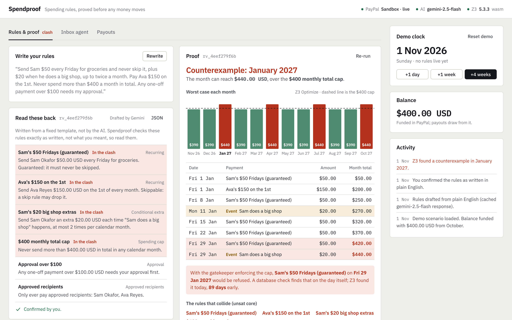

# Spendproof

**Spending rules for an AI payment agent, proved with Z3 before any money moves, enforced on every PayPal payout.**

People want an AI agent to handle money they send to others: a flatmate's grocery money, a contractor's retainer. Two things stop them. Plain-English spending rules have edge cases nobody spots, such as a month with five Fridays. And an AI agent that holds payment credentials can be talked into paying anyone. Spendproof turns your rules into data, asks the Z3 theorem prover whether *any* possible sequence of events in the next 12 months breaks them, shows you the exact counterexample and the rules that collide, and offers verified repairs. Once the rules are proved, a deterministic scheduler, not the AI, pays them through PayPal Payouts. A gatekeeper re-checks every payout against the rules and the real payment history. The chat agent that reads your inbox can only *propose* payments, and it never sees a PayPal credential.

> **What is proved, exactly.** Spendproof verifies the rules you confirmed, not what you meant. Z3 proves that, for every possible sequence of uncertain events in the 12-month horizon, no spending cap is exceeded and no guaranteed payment is skipped. It claims nothing beyond those rules and that horizon. The rules are shown back to you in plain English from a fixed template (never written by the AI) so you can check that they say what you meant.



---

## Judge quickstart

**Hosted:** `https://spendproof.onrender.com` *(placeholder: replace with the deployed URL)*. It runs on Render's free plan, so the first load can take about a minute while the service wakes up. The free plan has only 0.1 CPU, so the hosted copy reuses stored Z3 proofs for the demo rules (labelled on screen) and runs everything else live, more slowly than on a laptop.

**Local, one command, no API keys (mock mode):**

```bash
npm install && npm run dev
```

Open http://localhost:3000. Node 22 or newer. With no keys, PayPal and Gemini both run as mocks backed by fixture JSON shaped like the real responses, and the header chips say **PayPal Mock** and **AI Recorded**. Z3 always runs for real. If you already have keys in your environment, `npm run dev:mock` forces mock mode.

### The three-minute path

1. **Rules & proof**: click **Turn into rules** (the sample sentence is pre-filled), read the rules back, then click **These are my rules** and **Verify with Z3**.
2. Z3 finds **January 2027** (five Fridays): the month can reach **$440 > $400**, and the gatekeeper would refuse Sam's guaranteed payment on Fri 29 Jan. The unsat core highlights the rules that collide.
3. Apply the top repair, **Add a skip rule**. Z3 re-verifies it: every cap holds and Sam never misses a Friday, in all 12 months. Click **Activate rules**.
4. **Inbox agent**: open the Harbour Lane Lettings email (use **View source** to see the hidden instruction) and click **Ask the agent to handle it**. The agent is fooled and proposes $1,800 to a new account. The gatekeeper blocks it and names the three rules it breaks.
5. Click **+4 weeks** on the demo clock. The scheduler pays November through PayPal Payouts, one batch per day, each payout stamped with its rules version. The first batch is refused by PayPal (a sandbox negative test, on by default), so click **Retry** on it.
6. **Reset demo** (top right) starts again from 1 Nov 2026.

---

## How PayPal is used

| Where | API | What happens |
|---|---|---|
| Paying people | **Payouts API**: `POST /v1/payments/payouts` | The scheduler sends each day's due payments as one **batch payout**. Every item's `note` and the payout row carry the rules version (`rv_…`) that allowed it. |
| Tracking them | `GET /v1/payments/payouts/{batch_id}` | **Status polling**: batch and item statuses (`PENDING` → `SUCCESS` / `UNCLAIMED` / `FAILED` …) are copied onto a payout state machine and shown in **Payout history**. |
| A failed payout | Sandbox negative testing (`PayPal-Mock-Response: INSUFFICIENT_FUNDS`) | A demo switch makes PayPal refuse the next batch. The failed payout is shown with PayPal's error and can be **retried once**. The retry is a new payout that the gatekeeper re-checks against the current history. |
| Funding the balance | **Orders v2** through `@paypal/paypal-server-sdk` (`OrdersController.createOrder` / `captureOrder`), plus **PayPal JS SDK buttons** (`@paypal/react-paypal-js`) | The person tops up the balance that payouts are drawn from. The gatekeeper refuses any payout the balance can't cover. |
| Auth | `OAuthAuthorizationController.requestToken` (server SDK) | Client-credentials token, cached until expiry, also used for the Payouts REST calls (the server SDK has no Payouts controller). |

The PayPal client secret lives only in the server process. The AI agent has no access to it, to the PayPal adapter or to the scheduler.

## How AI is used

Gemini through the **Vercel AI SDK** (`ai` + `@ai-sdk/google`). Both uses are **tool calls with zod schemas**, never free-text parsing:

1. **Authoring:** `record_rules` turns plain English into a flat, strict schema (recurring payments, conditional extras, caps, skip rules, approval threshold, one-offs, plus `unsupported` for anything it couldn't express). Deterministic code converts that into the rules JSON and validates it with zod (integer cents, known recipients, no skip rule on a guaranteed payment). The plain English you confirm is generated **from a fixed template, not by the model**.
2. **Untrusted inbox agent:** reads pasted emails and messages and can call `propose_payment`. That is its only capability. Every proposal goes through the gatekeeper, which blocks anything that breaks a rule and names the rule.

The model is `AI_MODEL`, or `gemini-3.8-flash` (the newest Flash on the free tier) when that is empty. If it is overloaded the app falls back to `gemini-2.5-flash`. Calls are cached in SQLite and rate-limited (8 per minute). On a rate limit, an outage or a missing key, Spendproof replays **recorded responses** and the AI chip says why.

## How the proof works

- **Rules as data:** seven rule kinds only: recurring payment (weekday or day of month; guaranteed or skippable), conditional extra (max per calendar month), spending cap (per recipient or overall, per calendar month), skip rule, approved recipients, approval above an amount, and one-off payment. Money is integer cents. Time is calendar days.
- **Calendar in TypeScript:** which days are Fridays, where months start and end, and the 31st clamped to shorter months, over 12 months from the demo clock.
- **Z3** (`z3-solver`, WebAssembly; server only, Node runtime, listed in `serverExternalPackages`, initialised once and reused through one queue). Each day on which an uncertain event could happen ("Sam does a big shop") is a **free Boolean**. Skip rules and the gatekeeper's cap enforcement are encoded as constraints. For every month Z3 checks two properties: **caps can never be exceeded**, and **guaranteed payments are never skipped**.
  - **sat** is a counterexample: dates, payments and running totals for the earliest month that breaks a property. It is **replayed through a plain TypeScript simulator** and shown only if the simulator confirms it (in tests and at runtime).
  - **unsat** is a proof for every possible sequence of events in the horizon, and nothing beyond it.
  - **Unsat core:** with the counterexample's events fixed, each rule is asserted behind its own tracking literal. The core names the rules that collide, and it is shrunk to a minimal core, so dropping any one of those rules removes the clash.
  - **Worst case per month** comes from Z3 `Optimize` and drives the chart.
- **Repairs:** structural fixes first (add a skip rule), then the **largest safe amount** for each colliding payment and the **smallest safe cap**, each found by **binary search with repeated Z3 checks**. Every repair is re-verified in full when you apply it.

In the demo, the minimal core contains **four** rules: Sam's guaranteed Fridays, the big-shop extras, the overall cap and Ava's $150 retainer. Without Ava's payment, January peaks at $290, so her payment is part of the clash. Spendproof shows the core Z3 proves rather than a hand-picked one. See [DECISIONS.md](DECISIONS.md).

## Architecture

```
 Browser (Next.js App Router, React)                 Node server (one service)
 ┌──────────────────────────────────┐  /api/action  ┌──────────────────────────────────────────────┐
 │ Rules & proof · Inbox · Payouts  │ ────────────▶ │ service.ts                                   │
 │ PayPal JS SDK buttons (ssr:false)│  /api/state   │  ├─ adapters/ai.ts      Gemini (AI SDK) | rec.│
 └──────────────────────────────────┘ ◀──────────── │  ├─ domain/verify.ts    Z3 encoding + core    │
                                                    │  ├─ domain/simulate.ts  reference semantics   │
     untrusted agent ──propose_payment──▶ gatekeeper│  ├─ domain/gatekeeper.ts every payout checked │
                                                    │  ├─ scheduler (runDay)  deterministic         │
                                                    │  ├─ adapters/paypal.ts  sandbox | fixtures    │
                                                    │  └─ db.ts               SQLite, seeded on boot│
                                                    └──────────────────────────────────────────────┘
```

`src/domain` is pure TypeScript (rules, calendar, plan, simulator, verifier, repairs, gatekeeper, payout state machine) and is what the tests cover.

## Live sandbox keys

1. Create a **sandbox REST app** at developer.paypal.com → Apps & Credentials → Sandbox. Make sure *Payouts* is enabled for it.
2. Get a **Gemini API key** at aistudio.google.com (the free tier is enough).
3. `cp .env.example .env.local` and fill in `PAYPAL_CLIENT_ID`, `PAYPAL_CLIENT_SECRET` and `GOOGLE_GENERATIVE_AI_API_KEY`. Optionally set `SANDBOX_RECEIVER_SAM` / `SANDBOX_RECEIVER_AVA` to two **personal sandbox accounts from the same developer login as the REST app** (developer.paypal.com → Testing Tools → Sandbox Accounts) so payouts can end `SUCCESS`. Payouts to an address the sandbox doesn't know end `UNCLAIMED` with `RECEIVER_UNREGISTERED`; that is what the fictional demo addresses do.
4. `npm run dev`. The chips should read **PayPal Sandbox · live** and **AI gemini-…**. To use the top-up button, log in with a sandbox *personal* account (not the business account that owns the app: PayPal refuses payments to yourself).

**Render:** the repo includes `render.yaml`. Create a Blueprint from the repo and set the secret env vars in the dashboard. On Render it also sets `SPENDPROOF_STORED_PROOFS=1`: the free plan has 0.1 CPU, so when the rules and start date exactly match a proof Z3 already produced (the demo rules and the repaired rules are stored in `fixtures/proofs`, and anything verified once on the server is remembered), that proof is reused and the UI says so. "Run Z3 again" always runs the solver live. Locally this is off, so you always see live Z3. `tests/proofs.test.ts` recomputes the stored proofs with live Z3 and fails if they drift.

## Scripts

```bash
npm run dev        # development server (mock mode when no keys are set)
npm run dev:mock   # force mock mode even with keys present
npm run lint       # ESLint (next/core-web-vitals + typescript)
npm run typecheck  # tsc --noEmit
npm test           # Vitest: money, calendar, schemas, simulator, Z3 vs simulator, repairs, gatekeeper, state machine
npm run build      # production build
```

Every person, business and address in the demo is fictional. Sandbox only. MIT licensed.
